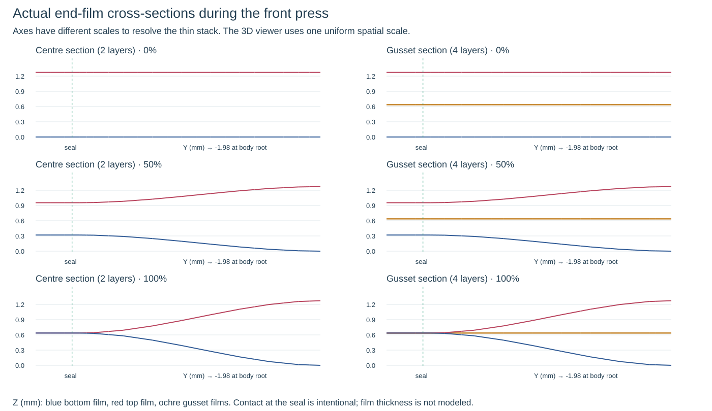

# End-film closure after both side walls are inward

The research viewer now tracks the source-material regions beyond both plastic
ends. Plastic remains rigid, one-sided 0.30 mm prisms. Film is deformable and has
zero modeled thickness. This is a conditional geometric path, not a physically
validated fabrication recipe. `manufacturingReady` remains false.

## Sequence

The corrected earlier sequence stays DOWN, UP, UP, first long seal, open the
pouch, then tuck the opposite wall inward. Earlier stages retain the verified
rigid-panel/local-strip model; their complete loose-membrane history is **not**
newly modeled. The full end-film model begins in the collapsed both-inward state:

1. Keep loose material beyond both end bands.
2. Bring the front overhang layers together outside every plastic panel.
3. Seal across the entire folded-film width, including gussets and long-fin join.
4. Flatten the rear overhang while retaining the front closure.
5. Seal the rear end; trim excess beyond completed seals afterward.

The heater bars illustrate normal access beyond all plastic; they do not model
actual heater housing, thermal spread, temperature, pressure or dwell time.

## Method and independent checks

The material atlas partitions the rectangular source blank into panel carriers,
half-hinge regions, seam overhangs and the existing longitudinal fin/weld. Each
patch retains source UV coordinates. Initial maps are isometries and shared
boundaries must agree. A common planar overlay triangulates all overlapping
layers identically. During pressing a smooth spatial taper reduces stack height
to a common end-seal plane, while leaving the body roots and plastic unchanged.
The existing long weld stays joined. Required film strain is explicitly measured.

Independent checks cover 3D triangle crossings, fixed roots, weld continuity,
planar heat-band contact and an axial separating plane from all plastic solids.
The overlay audit checks identical XY projections, positive projected triangle
areas, non-overlapping projected cells, and unchanged layer order at every
triangle corner. Affine height differences then retain their sign throughout
each triangle. This certifies the whole piecewise-linear mesh **at each sampled
frame**, not continuous time. Coplanar unbonded contact is permitted and is
distinct from welding. The film's finite thickness is not modeled.

Principal strains come from singular values of the material-triangle deformation
gradient. An attempted inextensible numerical relaxation was rejected because
it produced self-crossings. The implemented construction instead preserves rigid
plastic and reports film deformation without inventing an allowable strain.
There is no Python/SciPy dependency in the implemented model or reproduction.

## Results for the example

Dimensions: front/rear widths 80/64 mm, length 75 mm, nominal rise 30 mm, hinge
gap 4 mm and plastic thickness 0.30 mm. Research-only choices: 1 mm heated band,
25 mm source-blank margin, 2 mm retained long fin, and 2 mm end tail beyond each
heated band. These are example values, not measured fabrication settings.

Both end paths pass contact/root/weld checks at 21 frames each. Plastic meshes
remain byte-identical during end pressing. Maximum principal film strain is
about **0.4053%** on a 2 mm axial mesh; refinement to 1 and 0.5 mm gives about
0.3928% and 0.3851%, with no detected final-frame triangle crossings. Film
allowable strain and thickness are unknown. Strict isometry correctly fails.

The heat band includes **two central skins and four intended gusset layers**.
Four layers here are intentional; no unrelated patches are removed from the
thermal registry. The former front guide spanning only the large-panel width
misses the folded gusset/fin envelope: its limiting end needs about 4.0913 mm
extension in this example. Heat must cover the complete registry extent.

The first longitudinal weld must extend through both later end bands. The old
8 mm rectangular blank margin fails that coverage check here. The calculated
geometric minimum is about 9.66613 mm; this study uses 25 mm. That minimum is
specific to this geometry and heated-band choice, not a universal hardware
setting. Retaining only a 2 mm longitudinal fin is an explicit post-long-seal
trimming choice. Do not trim away material needed to join the three welds.

## Inlet and air passage

The user's actual inlet diameter is **unconfirmed**; “small” is not a dimension.
Its reference centre is 9 mm from the nearest end-band edge. The resulting
18 mm diameter bound concerns *end-band exclusion only*, not hardware clearance
or flow capacity.

A conservative unbonded two-skin material corridor connects inlet to body. A
deliberately added internal transverse weld blocks it in the negative test.
The rear cap centreline retains at least 0.64198 mm film-to-film height gap from
the reference inlet to the cap root. Every triangle-edge breakpoint is checked,
so the piecewise-linear centreline gap is bounded between samples too. Exact
segment-versus-convex-solid checks verify its continuation avoids all actual
plastic interiors; aiming a test path into the bottom panel fails. A finite
port radius, hardware intrusion, airtightness and pressure-driven flow remain
unverified.

## Other shapes and limitations

Rectangle, taper, longitudinal-tilt and lateral-tilt examples pass sampled end-film
geometry checks. Combined taper plus longitudinal tilt is explicitly **blocked**:
extended hinge patches disagree by about 0.0005143 mm where they meet outside
the plastic. Vertex deduplication must not hide this defect. A continuous
deformable transition map or another crease layout is needed for that case.

Complete earlier membrane motion, continuous-time collision certification,
finite film thickness, actual material strain limits and heater/physical tests
remain open. Generalized public fabrication-guide support stays withdrawn;
this research result does not automatically enable it.

## Reproduce and module boundaries

```sh
node designer/tools/study-end-film.mjs
node designer/tests/run.mjs
```

Open generated `designer/verification/end-film/viewer.html` directly (double-click
works), or serve the repository and use that same path. Report JSON, serialized
frames, overview SVG and section SVG are generated alongside it.

- Kernel: atlas, press geometry, validation, operation descriptions, tool meshes
  and complete supplied frames.
- Tool: filesystem output, case sweep, colours and camera framing.
- GUI: orthographic projection, visibility toggles and reversible playback;
  no solver, layer decisions or vertex interpolation.
- Public API/main designer: unchanged. The research schema does not promise
  supported fabrication across all public parameter values.


