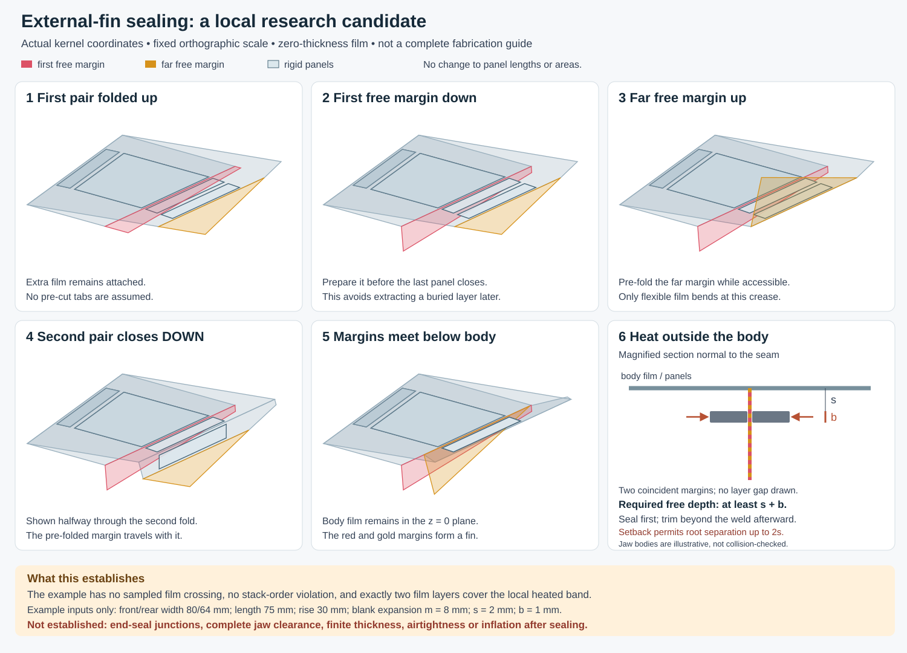

# Fabrication guide and geometric research

The public guide is limited to the original rectangular, equal-rise box with
both folding walls. The previously added generalized prefold guide has been
withdrawn. Its panels were rigid and seam endpoints matched, but film-layer
order and exterior sealer access had not been verified. Those geometric results
do not validate the former sealing instructions or their illustrations.

This is a new path, not a subdivision of synchronous hinge interpolation in the
legacy `assembly()` function. The latter remains available for compatibility.
The kernel generates ordered operations and independent rigid maps for all six
panels. The UI requests samples of one incoming operation at a time.

## Coordinates and construction

Let W be the virtual top/bottom width, L the axial length, and l half the maximum
rise. These are hinge-axis dimensions; physical panels are inset by g/2, using
the same outlines as the folding stencil. The bottom front corners are
A=(-W/2,0,0) and B=(W/2,0,0); corresponding rear points have y=L.

1. **Flat stencil.** Cross-section strip order is bottom, left-lower, left-upper,
   top, right-upper, right-lower. Each face retains its own vertex map so that
   the two copies of the closing seam remain distinct before sealing.
2. **Half fold.** Rotate the last three panels together by pi about E-J, the
   second marked solid fold. Rodrigues' rotation specialized to this y axis is
   an exact isometry. Afterward the top is translated by (-2l,0,0) relative to
   the bottom. Both outer copies of B-C coincide.
3. **Long seal.** No panel motion. The kernel emits two coincident ideal seam
   segments and records the longitudinal seam as closed.
4. **Inlet.** No panel motion. The marked circle moves with the top allowance.
   Inlet fitting/puncture instructions occur before end closure.
5. **Open the pouch.** For theta from 0 to pi/2, set
   d=(-2l cos(theta),0,2l sin(theta)). The top corners are the bottom corners
   plus d; both wall midhinges are their corresponding bottom corners plus d/2.
   Each wall half has length |d/2|=l, and all axial edges have length L. All
   rectangles remain rigid and all six longitudinal connections close. The
   ending upright box is exactly the opening=1 pose of the inward-fold branch.
6. **Fold inward and flatten.** With u decreasing from 1 to 0, let h=2lu and
   q=l sqrt(1-u^2). Left midhinges have x=-W/2+q, z=h/2; right midhinges have
   x=W/2-q, z=h/2. The top translates only in z by h. Thus q^2+(h/2)^2=l^2:
   each wall half remains congruent. At u=0 the top and bottom overlap and the
   wall creases face inward (><).
7. **Front seal.** Hold the flattened configuration; the front top/bottom
   allowance lines both lie at y=-(l+c), z=0 and have identical endpoints.
8. **Rear seal.** Hold the same configuration; the rear paired lines lie at
   y=L+l+c, z=0. The kernel retains all completed seal IDs.

Reversing a step samples that same operation in reverse. No world-vertex
interpolation is performed in the UI. The same viewing envelope covers all
rotation arcs, so advancing does not refit or zoom the camera.

## Evidence and limits

`fabrication.validate` samples every operation and checks all pairwise physical
panel vertex distances, panel areas, both endpoints of every hinge, closure
after the first seal, continuity between neighboring operations, and paired seal
endpoints at sealing stages. Interior samples of the moving operations are also
checked for zero-thickness surface crossings. Flat endpoints intentionally stack
and are not treated as impossible sheet intersections.

The distance and closure identities above establish the ideal rigid linkage;
numerical tests guard implementation error. Collision checks are sampled, not
a continuous collision certificate. Positive-thickness panels need stack offsets
and compliant film hinges that this ideal instructional model does not solve.

The four translucent top/bottom allowance strips are schematic guides carried
by their parent plates. Paired guide endpoints really coincide in the flattened
sealing pose, but a full inextensible membrane, inward-folded end gussets, airtight
seal widths, the inlet hardware and post-seal inflation are not simulated.
The last two stages stay flattened; leaving the guide returns to the separate
actuation preview rather than falsely transporting sealed film as rigid plates.


## Withdrawn generalized route: geometry is not a fabrication proof

The finished 3D closed linkage and a particular single-hinge fold of the open net
are different geometric questions. For example, with front/rear widths 80/64 mm,
length 75 mm and equal maximum rises 30 mm, rotating the entire tail by pi about
E-J leaves the closing-seam endpoints displaced by 6.3639 mm. The parallel lines
are only 0.675 mm apart normally; endpoint displacement is not the normal gap.
This is a limitation of that fold choice, not an impossibility of the actuator.

Two side-pair prefolds can align the seam endpoints and stack the large panels.
Changing a 180-degree fold from upward to downward gives the same rigid endpoint
but a different path and material-layer order. Sealing through a stack cannot be
justified by excluding coplanar contacts from a motion collision audit.

`fabrication-motion.mjs` and the private generalized program remain available to
geometry regression checks. `fabrication.describe` returns unsupported with
`SEAL_LAYER_ACCESS_UNVERIFIED`; `fabrication.pose` rejects the withdrawn route.
`fabrication.validate` may still return `numericalPass: true` for the rigid
geometry, but also returns `validationScope: 'sampled-rigid-panel-geometry'`,
`manufacturingReady: false`, `sealLayerAccess: 'unverified'` and
`guideAvailable: false`. These are deliberately separate claims.

## Local external-fin candidate

The newer [wall-tuck study](wall-tuck-study.md) implements the user's proposed
double-and-swing order and finds an exposed two-layer first-seal footprint on
the existing net in the checked nonzero-rise cases. The external-fin study below
is retained as a separate exploratory alternative, not the current route.



`kernel/film-seal-study.mjs` is pure, headless research code, separate from the
public fabrication API and GUI. It keeps a full rectangular material-coordinate
film blank; no narrow tabs are secretly pre-cut. Each clipped film patch has an
isometric placement, and rigid panels remain attached to their original material
coordinates. The candidate sequence is:

1. Fold the first side-pair middle crease upward, carrying the tail.
2. Fold the first free film margin downward while it is accessible.
3. Pre-fold the far free margin upward while it is still accessible.
4. Close the second small-panel pair downward, carrying its pre-folded margin.
5. Heat the two resulting external margins below the body, then trim beyond the
   weld. Do not try to pull buried margins out after the body closes.

The blank expansion `m`, heated-band width `b`, and setback `s` are explicit
positive study inputs, never hardware defaults. Both margins must cover the
whole band, with free depth at least `s + b`. All other film must stay outside
the local band and simplified horizontal approach corridor. The full sealer
housing is not represented. The rectangular blank's actual material coverage
is checked, not inferred from the nominal margin alone.

The setback also changes the mechanical constraint: each root-to-weld material
path has length `s`, so the triangle inequality allows the two corresponding
seam roots to separate by up to `2s`. This is an upper allowance, not a prediction
that the roots will separate by that amount. The welded fin therefore does not
enforce the coincident B-C roots assumed in the ideal closed linkage. A narrower
heated band alone does not remove this freedom. The eventual physical design
must reconcile tool clearance with acceptable seam-root freedom before the
existing actuation path can be claimed for this sealing arrangement.

The study samples film crossings and material isometry, checks panel attachment,
rejects folds through rigid panels, and checks departure order from a coplanar
stack. The heater audit counts every overlapping material patch, including
coplanar and partially overlapping extra layers. The two target material normals
must oppose. Extra film is retained throughout this study, including sealing.

Reproduce the report and SVG with:

```sh
node designer/tools/study-external-fin.mjs
```

The illustrated 80/64 mm taper example, with 75 mm length, 30 mm rise,
`m=8`, `s=2`, `b=1` mm, passes these local checks at 201 samples per fold.
A 27-case width/pitch/lateral-ratio grid passes at 101 samples per fold. These
are explicit examples, not a general domain proof. Negative controls matter:
closing the second pair upward causes film crossings; extracting margins after
closure violates stack order even when a noncoplanar crossing test passes.
Insufficient margins fail, and a zero-rear-rise example is rejected because its
rectangular-blank margin straddles the next fold.

Every result still returns `manufacturingReady: false`. The complete end-film
folds, junctions between longitudinal and end seals, real jaw clearance, positive
thickness, airtightness and inflation after sealing remain unverified. Passing
the local candidate does not enable a public generalized fabrication guide.
