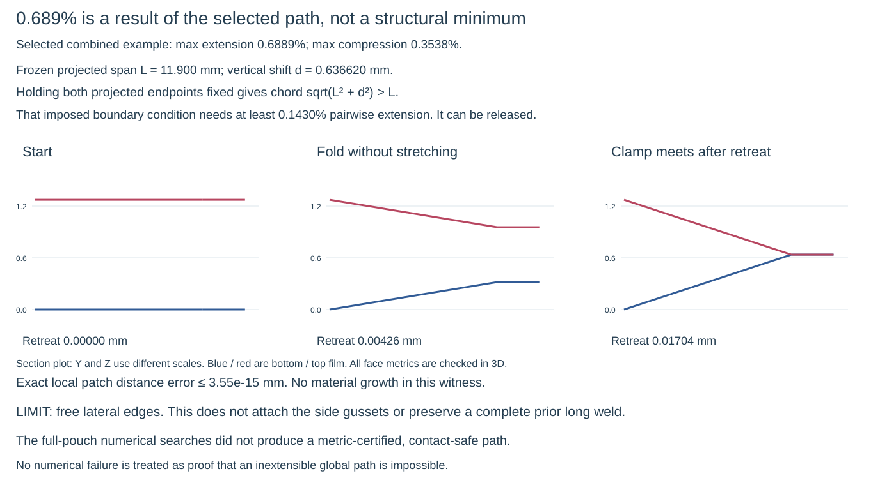

# Is 0.69% film extension necessary?

**No structural minimum was established.** The previous number is a metric of
one selected smooth press map. Calling it a required material extension without
that qualification was too strong. The current results distinguish actual
extension, compression, a restricted-boundary lower bound, an exact local
nonstretching construction, and the still-unverified complete pouch.

## What the old map does

The combined example has width 80/64 mm, length 75 mm, rise 30/18 mm, plastic
thickness 0.30 mm and gap 4 mm. The finite plastic stack is kept fixed while the
loose end film is smoothly pressed toward a plane. The film metric is obtained
from the singular values of each source-UV triangle's deformation gradient.

| End | Maximum principal extension | Maximum principal compression |
| --- | ---: | ---: |
| Front | 0.34773% | 0.32128% |
| Rear | 0.68893% | 0.35377% |

Thus some material directions really do lengthen in that numerical map; the
number is not merely projected image area or rigid-panel rotation. It is a
local maximum, not a uniform elongation of the entire film. No constitutive
law, stress field or physical strain measurement is implied.

## Why frozen clamp coordinates force some extension

Consider one material line from the fixed cap root to the inner clamp edge.
In the rear example its unstretched length is `L = 11.9 mm`. Moving its clamp
point vertically by `d = 0.636619766 mm`, while keeping the original projected
span `L`, gives endpoint distance `sqrt(L² + d²)`. This exceeds the material line
length. No bending or wrinkle can make a line's endpoint chord exceed its arc
length without extension.

For **that imposed endpoint condition**, the necessary pairwise extension is
at least `sqrt(L² + d²)/L - 1 ≈ 0.142997%`. This is neither the 0.68893% local
maximum nor a lower bound after releasing the clamp's projected position.
Freezing a convenient root ring and prescribing the same smooth height taper
are additional modeling choices, not requirements supplied by the user.

## An exact local counterexample to the fixed-position requirement

The central top and bottom strips can each be two rigid film patches joined
by a transverse crease. Their root lines stay fixed. Let

```
theta(p) = asin(p * d/L),  0 <= p <= 1
ramp(s)  = (x, -s*cos(theta), z_root +/- s*sin(theta)), 0 <= s <= L
tail(s)  = (x, -L*cos(theta) - (s-L), z_root +/- L*sin(theta)), s >= L
```

Each patch map has orthonormal material basis vectors, so every in-plane length
and area is preserved. At `p = 1` both tails meet the same plane and XY position.
The clamp retreats by `L - sqrt(L²-d²) ≈ 0.01704097 mm`. Across 61 frames, the
maximum patch distance error is about 3.55e-15 mm, area error about 2.84e-14 mm²
and crease-boundary continuity error zero.

This is an **exact local witness with free lateral boundaries**. It does not
attach the side gussets or preserve the whole previously welded longitudinal
fin. It must not be promoted to a complete nonstretching pouch solution.
The 0.017 mm is a computed example, not a practical sealer positioning setting.

## Whole-cap numerical searches

The research search keeps the finite plastic and root material fixed, preserves
existing longitudinal-weld point identities exactly, and attempts material-edge
length constraints while allowing new fold angles. Variants release clamp XY,
release point correspondence at the new weld, flatten only the heated band,
add lateral mesh creases, and seed nonplanar wrinkles.

| Candidate | Maximum remaining edge-length error | Disposition |
| --- | ---: | --- |
| Free clamp XY, fixed material correspondence | 0.007336 mm | Rejected |
| Sliding new-weld correspondence, planar tail | 0.006526 mm | Rejected |
| Only heated band held planar | 0.005574 mm | Rejected |
| Added lateral creases and small wrinkle seed | 0.011301 mm | Rejected |
| Larger axial wrinkle seed | 0.018360 mm | Rejected |
| Free unbonded hinge film inside body, actual attachments fixed | 0.020292 mm | Rejected |
| Dense follow-up of the released-hinge model | 0.020238 mm | Rejected |

The released-hinge variant extends the domain 6 mm into the body, explicitly
splits plastic attachment boundaries, and fixes every bonded film vertex while
leaving unbonded gap film free. It tests the artificial-root-ring assumption
rather than treating it as a physical requirement. Because this domain overlaps
the body, axial separation no longer proves plastic clearance; a successful
candidate would additionally need full triangle/prism contact checks.

These candidates are not inextensible and are not used as manufacturing frames.
An optimizer status is never a rigidity/contact certificate. Failure of these
finite meshes and initial guesses proves neither impossibility nor a positive
minimum strain over arbitrary crease patterns. A future accepted candidate
must pass edge, principal-metric, area, material-continuity, prior-weld,
finite-plastic, self-contact and heater-layer tests, plus the full approach path.

## What the literature does and does not establish here

[Tachi, *Capping Rigid Origami Tubes* (IASS 2017)](https://origami.c.u-tokyo.ac.jp/~tachi/cg/TachiCapping2017IASS.pdf)
discusses the Bellows-theorem obstruction for volume change of a closed
polyhedron with isometric rigid facets, and compliant or slit/hole approaches.
That does **not** prove our pre-seal fabrication is impossible: the end boundary
is open until welding, real film may form new or curved wrinkles, and the actual
inlet is a hole. The current numerical end mesh does not explicitly cut the
unknown inlet bore or model its flange attachment boundary. Those distinctions
must be resolved before asserting a global theorem for this actuator.

## Current conclusion and reproduction

- The reported 0.69% includes genuine local extension in the selected map.
- It is **not** an established structural requirement.
- Exact nonstretching closure is demonstrated for the central two-strip
  subproblem after releasing the clamp position.
- A continuous, contact-safe, nonstretching path for the **entire sealed pouch**
  has not been verified. It is also not proven impossible.

```sh
node designer/tools/study-film-isometry.mjs
node designer/tests/run.mjs
```

Use `--write-search-problems` with the study tool to generate JSON inputs for
free-clamp, heated-band-only and released-hinge variants. The Python adapter
accepts `problem.json result.json max_evaluations seed_wave_mm`; failed search
outputs remain research evidence, not accepted fabrication poses.

Generated `verification/film-isometry/report.json` records the signed metric
results and available rejected searches. `local-viewer.html` and the section
figure explicitly state the local scope. The optional Python search is isolated
from browser/API runtime; it needs NumPy/SciPy (locally under ignored
`verification/research-python`) and JSON problems/outputs. It is a research
tool, not a solver that silently enables fabrication.


