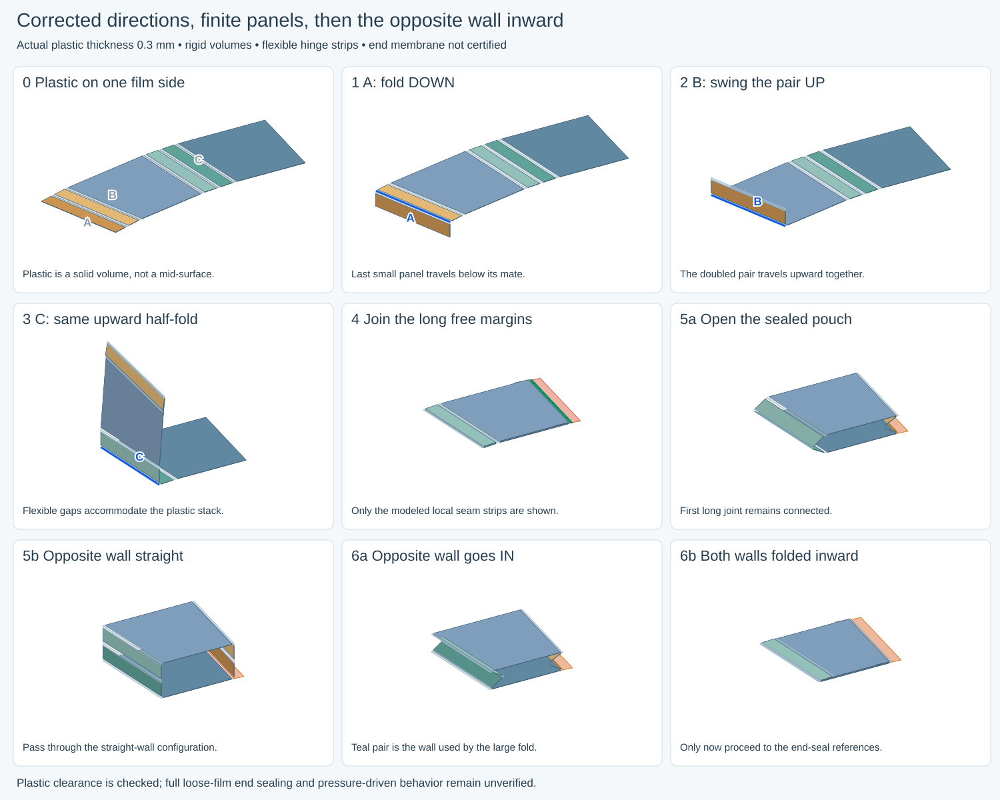
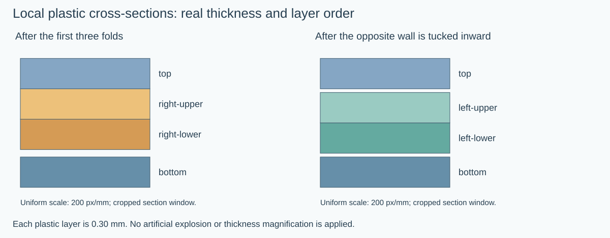

# Corrected directions and finite plastic panels

The user corrected the fabrication branch: **A down, B up, C unchanged/up**.
After the first long seal, the opposite side wall (used for the large fold) must
also be put inward before either end is sealed. The current offline viewer uses
this corrected route. Earlier upward/downward direction illustrations are superseded.



## Solid plastic, with a defined attachment side

The flat film defines a material normal. Plastic starts on its positive side,
extending from the bonded film surface through the specified panel thickness.
The example uses the design spec's 0.30 mm plastic thickness and 4 mm hinge gap.
Every panel is a closed convex prism with rigidly transformed vertices; top,
bottom and side faces are actually present. Thickness is not a display offset.

Simply extruding the earlier coincident surfaces makes the top plastic intersect
the right-lower plastic. The finite model detects that collision. It accommodates
stack thickness through the unbonded film gap: straight legs and a circular bend
retain total material width `g`, while the child panel group keeps one rigid
transform. The bend radius is searched within `0 <= radius * abs(angle) <= g`
and the finite prism trajectory is sampled, including additional near-end poses.
Insufficient gap/thickness combinations report interference instead of passing.

The example's computed clearance radii are about 0, 0.30001 and 0.63662 mm. These
are model accommodation results, not measured film bend radii. Film thickness
and its minimum bending radius remain unverified; a zero-radius fold is an
ideal thin-film limit. The plastic itself always has positive thickness.



These cropped sections use the same physical scale in both directions, without
exploding the layers. Each plastic layer is 0.30 mm thick. The first section
contains bottom / right-lower / right-upper / top. After the opposite-wall tuck,
the left section contains bottom / left-lower / left-upper / top.

## First seal, then the opposite wall inward

1. Fold the last small panel **downward** about A.
2. Swing the doubled pair **upward** about B.
3. Fold the remaining strip **upward** about C.
4. Bring the two loose free-edge margins together and make the first long seal.
5. Open that pouch along the branch with the opposite wall still outward.
6. At the straight-wall configuration, change that opposite wall to the inward
   branch and flatten. The already prepared wall stays inward.
7. Only then proceed to the front and rear end-sealing locations.

Finite-panel post-seal poses preserve all panel rotations/shapes. Small rigid
translations accommodate the finite stack while enforcing two gap conditions:
physical bonded-edge separation must not exceed available unbonded film width,
and there must be no axial slip along the hinge. The projection solve keeps the
bottom fixed. Prism collisions, rigid distances and gap constraints are checked
through both post-seal branches. Matching endpoints are checked at their join.

Local gap strips can join the two parallel edges with two inextensible facets.
Free seam overhangs each retain length `g/2`; their common joint maintains the
long connection during opening and the inward tuck. The heated footprint is
placed beyond the projection of all modeled body solids/hinge strips. In this
example that requires about 0.00591 mm outward offset from the common guide.
This is a geometric clearance example, not a real sealer setting. Unbonded film
and contact leave extra freedom; this is an admissible path, not a unique
pressure-driven motion prediction.

## Evidence and explicit limits

The example is checked at 201 samples per post-seal branch, with sampled finite
prefolds and endpoint refinements. Rectangle, taper, pitch, combined taper/pitch
and lateral-tilt examples pass at 151 samples per branch. Tests also check closed
solid volumes, vertex-pair rigidity, unchanged hinge material width, layer order,
seam closure, exact stage joins and rejection of insufficient hinge gap.

The earlier full-blank **zero-thickness** material audit remains a separate
topology check. It is not automatically promoted to finite-thickness membrane
validation. This new model checks finite plastic and local flexible strips;
complete loose film, end gussets, interactions among every flexible strip,
actual heater housing/thermal spread and pneumatic behavior are not solved.
The last two viewer stages are therefore **end-seal references**, not validated
end-membrane animations. `manufacturingReady` remains false.

## Reproduce and implementation boundaries

```sh
node designer/tools/study-wall-tuck.mjs
```

Open `designer/verification/wall-tuck/viewer.html` in a browser. The compatibility
entry now runs `study-wall-tuck-thickness.mjs`; the report, frames and figures
are regenerated alongside it.

- `kernel/thick-folds.mjs`: finite prisms, one-sided attachment, length-preserving
  fold accommodation and sampled collision search.
- `kernel/wall-tuck-thickness.mjs`: box branches, finite gap projection, local
  seam connection, layer sections, operation order and narration.
- `ui/sheet-study-document.mjs`: projection and playback of supplied faces/frames;
  it computes neither thickness nor fold trajectories.
- The existing main editor and public generalized fabrication-guide support
  remain unchanged; this is a separate research viewer.
