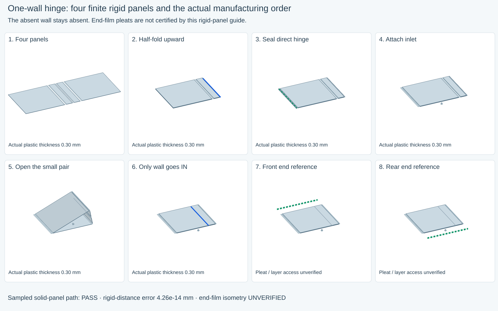

# One-wall hinge fabrication guide

Removing either small-panel pair now makes the existing **Fabrication guide**
available for the resulting four-panel actuator. No type selector is added.
The kernel owns the steps, finite panel geometry, gap strips, inlet, seal cues,
frame envelope and verification summary. The generic UI plays API poses.

The sequence is:

1. Prepare bottom, small, small and top panels on film.
2. Half-fold upward at the remaining small pair's middle.
3. Join the free long margins to form the direct film hinge on the absent side.
4. Attach the inlet before closing the ends.
5. Open until the remaining two small panels are straight.
6. Push that pair inward and flatten.
7. Arrange the front end film and seal.
8. Repeat at the rear, preserving the inlet passage; trim beyond the seals.

The last two steps are instructional **end-film references**, not metric-certified
end-pleat animations. No stretched end membrane is rendered and presented as
an isometric fold. Their `activeSeal.status` is `unverified-end-film`; there is
no falsely coincident end-band clamp animation. The guide remains useful for
the actual operation order while exposing the precise missing verification.

## Finite panels and inward tuck

`hinge-fabrication-geometry.mjs` builds a four-panel material hinge program.
The half-fold travels upward. Its flexible bend reserves enough real separation
for the later four-layer inward stack, not just the initial two overlapping
large panels. In the 0.30 mm plastic / 4 mm gap example, the stack film height
is about 1.20002 mm. The radius cannot consume more material width than the gap.
An insufficient combination is rejected, not rendered with interpenetrating
panels. This study requires positive plastic thickness.

The post-seal outward and inward branches join at the straight-small-panel
configuration. Every panel keeps one rigid transform; the bottom stays fixed.
Small rigid translations enforce gap reachability and zero axial slip. Local
gap strips have two equal-length facets. The long margins meet outside the
plastic and retain a joined local seam as the hinge opens and its side tucks in.
These gap checks do not certify interactions among all unmodeled loose film.

Tests cover both absent sides and rectangular/tapered hinge outlines, all
panel vertex-pair distances and physical thickness, exact stage joins, actual
outward-to-inward motion, seam coincidence, JSON transport and generic forward/
reverse playback. The example is sampled at 151 positions per operation.
The guide's availability is not a manufacturing or airtightness certificate.

The upper/lower plates create a triangular side profile at the straight-wall
limit. It is equilateral only for the corresponding side-length choice; the
software does not label every parameterized hinge an equilateral triangle.

```sh
node designer/tools/study-hinge-fabrication.mjs
```

The generated `verification/hinge-fabrication/viewer.html` is self-contained and
double-clickable. The main designer uses the same kernel route through the
existing versioned API. Full nonstretching end closure remains the separate
[film isometry review](film-inextensibility-review.md).


