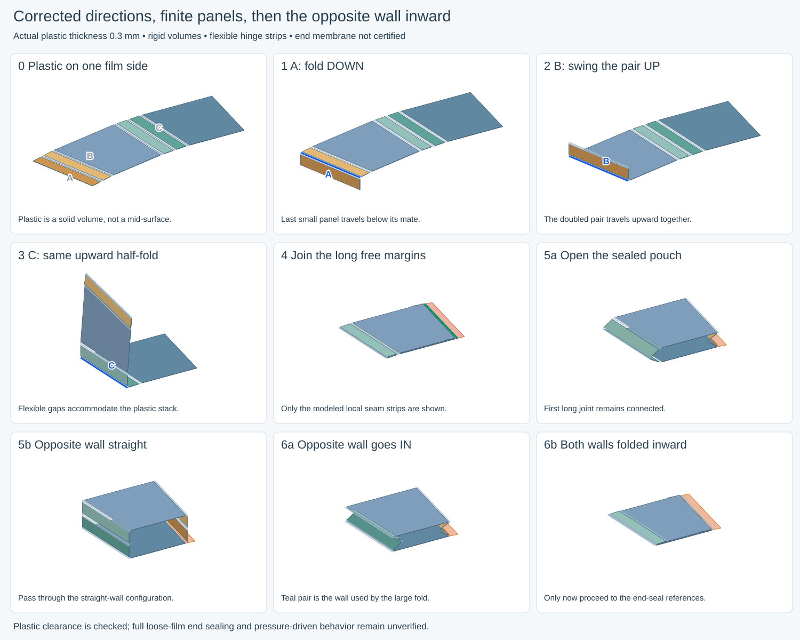

# Double a wall, swing it inward, then overlap the large panels

This implements the user's proposed order as a first-long-seal research study.
It retains a full rectangular film blank and uses three existing panel joints.
It does not fold free margins into a new external fin.



## The exact axes and order

The open strip is bottom, left-lower, left-upper, top, right-upper, right-lower.
The three operations are:

1. **A = M-N, right-wall middle.** Fold right-lower onto right-upper, carrying
   its free film. In the displayed orientation the last panel moves upward.
2. **B = F-G, top/right-wall boundary.** Swing both small panels inward together.
   The doubled panels travel downward; their loose free-end margin travels
   upward, clear of the body film. The opposite swing direction passes through
   an already deposited film layer and is rejected.
3. **C = K-L, opposite-wall middle.** Fold the prepared tail over to overlap the
   large panels. This is an important axis choice: using the former E-J central
   half-fold at this point leaves a 30 mm seam mismatch in the 80/64 mm example.

After A, the free B-C copy of the last panel coincides with the F-G root of its
mate. Rotation B is about that same root, so it changes which side the folded
wall occupies while keeping that free-edge copy fixed. Operation C then brings
the large-panel corners and both seam endpoints together. The implementation
checks pair collapse, top/bottom overlay and seam agreement independently.

## What the first sealing check means

The finite heated band starts at the matched guide and extends **outward** into
the free film margins. For the illustrated 1 mm band and zero outward offset:

- Exactly two material patches cover the whole heated footprint, one from each
  free end; their material face normals oppose.
- No other film patch partially enters that footprint, and no rigid panel enters it.
- The final ideal sheet is planar, so a jaw with precisely that footprint can
  approach normally from either side without another layer occluding the targets.
- In the same example, the immediately inward band contains four body-film layers.
  Centering a finite-width heater on the guide therefore includes unwanted layers.

This checks a heated footprint and its normal access, not the full sealer housing
or thermal spread. Margin, heated width and outward offset are explicit study
inputs. The 8 mm blank expansion and 1 mm heated width in the figure are examples,
not actual hardware defaults. Excess film is retained throughout the simulation;
the operation would be sealed first and trimmed afterward.

## Evidence and rejected controls

The example uses front/rear widths 80/64 mm, axial length 75 mm and rise 30 mm.
It passes at 201 samples per fold. A 27-case width/pitch/lateral ratio grid passes
at 151 samples per fold: worst panel distance error is about 1.85e-13 mm, film
boundary mismatch about 2.12e-13 mm, and final seam mismatch about 1.12e-12 mm.
No sampled noncoplanar panel/film crossings or stack-departure violations occur
in that grid. These are sampled implementation checks, not a continuous proof
for all parameter values or finite thickness.

The wrong swing direction is rejected even though its final rigid geometry and
seam guides are identical. The former central final axis is rejected for seam
mismatch. A zero-rear-rise example retains rigid panels and closes the guides,
but the proposed three-crease continuation would separate shared material points
in the extra end film by about 10.18 mm; it is rejected. This invalidates that
crease program for that blank, not the actuator itself. Additional end-film
creases or a different handling sequence would need to be modeled explicitly.

Complete end-seal junctions, finite-thickness stacking, the actual sealer body,
airtightness and pressure-driven motion remain unverified. Results retain
`manufacturingReady: false`; this study does not enable the withdrawn generalized
public fabrication guide.

## Reproduce and view

```sh
node designer/tools/study-wall-tuck.mjs
```

Open `designer/verification/wall-tuck/viewer.html` directly in a browser; it is
self-contained and works offline. Use previous/next to advance or rewind a fold,
and the Fold slider to inspect its angle. The camera uses a fixed orthographic
scale across steps; explicit orbit, pan, zoom and touch controls only affect view.
The SVG and JSON report are written alongside it. Regenerate after kernel changes.

## Boundaries for a future direct-fold editor

- `kernel/surface-contacts.mjs`: generic convex surface/prism contacts; no box solver.
- `kernel/sheet-folds.mjs`: neutral material-coordinate sheet and rigid panels,
  declared hinges, moving-panel sets, signed angles, exact rotation samples,
  material continuity, attachment, hinge and collision audits.
- `kernel/wall-tuck-study.mjs`: box-specific axes, operation order, narration,
  timing, seam tests, heater footprint and storyboard frames.
- `ui/sheet-study-document.mjs`: generic frame player and projection only. It
  contains no box construction or fold solver and never interpolates vertices.
- `tools/study-wall-tuck.mjs`: orchestrates kernel output, presentation styles,
  JSON transport and standalone viewer/figure generation.

The program is JSON-serializable and tests also use an unrelated two-panel sheet.
The current viewer scrubs a prescribed program. A future direct editor can select
declared joints and signed angles, then request new poses and diagnostics from
the kernel. Arbitrary prior nonflat stacks need a fuller layer-order model: the
current stack-departure audit explicitly covers horizontal flat starting stacks
and reports incomplete coverage for other starting arrangements.
